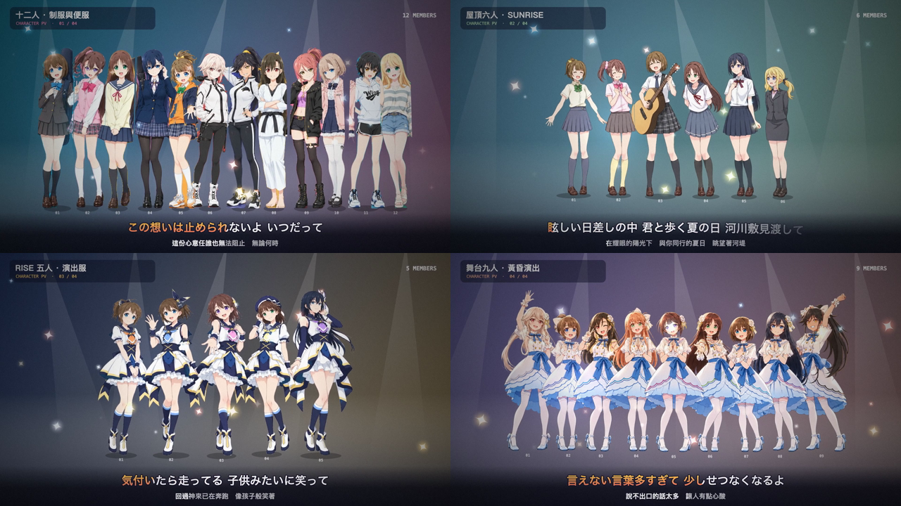

# NewEffects

首頁是 BEST 4U 歌詞 PV（`index.html`）；第二版本 `v2.html` 是動態歌詞播放器：在 YouTube 影片或本機 MP3 上疊加動態歌詞特效，並提供參考人物與 Q 版偶像的「載歌載舞」舞台。

## 啟動

```bash
./serve.sh
```

macOS 也可雙擊 `啟動播放器.command`，會在終端機啟動伺服器並開啟頁面。兩種方式都會使用 http://127.0.0.1:8765，按 Ctrl+C 停止這次啟動的伺服器。

可用 `./serve.sh 8766` 指定其他埠號（1–65535）。若同一埠號已有播放器，會直接開啟；若被其他程式占用，會提示改用其他埠號。指令檔可從任意工作目錄執行，檔案路徑也可包含空格。需要 Python 3 與 curl；YouTube 嵌入需要透過網址開啟，不能直接雙擊 HTML。

## 功能

- 首頁 PV 與第二版播放器皆提供 0–100% 音量滑桿及靜音按鈕；設定共用並自動記住，適用於 MP3、本機影音及第二版的 YouTube 音源。
- 兩版播放器皆有「上一首／下一首」按鈕，依歌曲清單順序循環切換，保留播放或暫停狀態與音量；首頁切歌也會保留人物 PV 模式。
- 兩版歌曲清單將同一首歌的版本放在一起，固定依中文 → 英文 → 日文 → 粵文排列；上一首／下一首跟隨此順序。既有歌曲網址編號與第二版已存的歌曲 ID 保持不變，使用者匯入的歌曲也會保留。
- 兩版皆可按「−5秒／+5秒」倒退或快轉，會限制在歌曲起訖範圍內；進度條拖曳、鍵盤操作及中斷拖曳後均會繼續跟隨播放時間。
- 歌詞特效：卡拉OK填色、逐字彈跳、霓虹燈、逐字浮現、柔焦夢幻
- 雙語字幕（原文＋繁中）：SRT 每段第二行放繁中翻譯，顯示在英文、日文或粵文原文下方並隨時間填色；下一句預覽也同步顯示雙語
- 和聲（`［］`、`《》`、`[]`、`()` 內文字）以小字淺藍色顯示；`漢字(かな)` 與 `English phrase(カナ)` 顯示為上方注音假名
- 載歌載舞：每位卡司成員會抬手、側擺、踏步及跳躍；可切換參考人物／Q 版、選擇主唱並調整舞動強度。人數跟著該首歌的卡司走（best4u／anaru 六人、招財喵布布八人、超かぐや姫！三人），主唱選單會依歌曲重建
- MP3 以低頻偵測節拍，中頻音量驅動主唱嘴型與音符；嘴型為音量開合效果。YouTube 因無法取得音訊，使用固定 120 BPM
- 桌面舞台和控制列適應視窗高度，側欄獨立捲動；手機直向排列。長歌詞自動縮放至最多兩行，避免被舞台裁切
- 打點對時：貼上歌詞後按「開始打點」，每句開始時按 Space，可匯出 LRC
- 支援匯入 LRC／SRT，歌曲清單可新增 YouTube 網址；歌詞面板的「匯出雙語 SRT」可輸出目前時間軸的中日雙語字幕

## 歌詞 PV

新增 Suno 歌曲的英、日、粵版本已補齊繁體中文對照，共 24 個版本、1,293 段字幕。原文、句數、音訊與已核對的起訖時間均保留；`assets/ref/` 各曲目資料夾內的 `translations-zh.json` 逐行保存翻譯，既有 `tools/build-*-subtitles.mjs` 透過共用 `tools/bilingual-lyrics.mjs` 重建雙語 SRT，重唱段落引用同一組原文與翻譯。生日祝福曲的國語、英文、日文版原本就有雙語；粵文版補上 20 段繁中對照，時間軸沿用已核對的粵文歌詞。首頁、第二版及 MP4 共用相同字幕。

`lyric-text.js` 統一移除所有歌曲字幕顯示中的標點與裝飾符號（含原文及繁中翻譯），保留文字、數字、日文長音與注音；原始歌詞／SRT 資料、歌名、操作介面及對時不改寫。第二版匯出 LRC／雙語 SRT 也不帶標點。執行 `node tools/test-lyric-text.mjs` 可驗證兩版解析一致、雙語、注音及數字；此次依實際字幕差異只重做 41 首 MP4，5 首未變動版本不重做。

首頁 `index.html` 是每首歌的歌詞 PV（1920×1080），用同一套 `pv.js` 在瀏覽器即時預覽，或輸出成 MP4；原本的動態歌詞播放器改為第二版本 `v2.html`，兩頁互相有連結：

- 預覽：開啟 `http://127.0.0.1:8765/?song=0`（0 大好きだよって叫ぶんだ、1 SUNRISE、2 HELLO HERO、3 風の中は走るっきゃないっ！、4 ぴ、5 統一發票頭獎得主鋒兄威力彩頭獎得主塗哥、6 私は、わたしの事が好き。、7 カニ☆Do-Luck!、8 ユラリユレル、9 明日へのBreakShoot [葉山陽和ver.]、10 統一發票頭獎得主鋒兄威力彩頭獎得主塗哥(英文歌詞)、11 統一發票頭獎得主鋒兄威力彩頭獎得主塗哥(日文歌詞)、12 統一發票頭獎得主鋒兄威力彩頭獎得主塗哥(粵文歌詞)、13 後はやるだけ！ [V西2025]）
- 輸出：`node render-pv.mjs`（`pv.js` 裡的全部歌曲分批輸出到 `pv/`，預設同時兩首，可用 `--jobs 3` 調整），或 `node render-pv.mjs 1 --from 60 --to 72` 只輸出片段。需要 Google Chrome 與 ffmpeg；Windows 可自動找到標準安裝位置的 Chrome，NVIDIA 顯示卡可加 `--encoder h264_nvenc` 使用硬體 H.264 編碼。

人物由使用者提供的參考圖去背切出來：把參考圖放進 `assets/ref/`（`rise5.webp` 五人演出服白底、`lineup12.webp` 十二人色條底、`rooftop6.webp`、`stage9.webp`），執行 `node tools/cutout.mjs` 產生 `assets/ref/cast/` 的角色 PNG 與 `cast.json`。每首歌的主視覺與成員在 `pv.js` 的 `ARTS`、`SONGS[].cast` 設定（`lead` 是主唱，預設第一位）：大好きだよって叫ぶんだ 用 RISE 演出服，SUNRISE 用制服，HELLO HERO 用智的隊伍，風の中は走るっきゃないっ！ 用生徒会六人（`assets/ref/cast/anaru-*.png`，主視覺 `assets/ref/anaru6.png`），統一發票頭獎得主… 用招財喵布布八人（見下節），私は、わたしの事が好き。用超かぐや姫！三人（見下節）。角色以切圖分條彎曲、跳躍、壓縮做出跟拍舞動。

### 超かぐや姫！三人（畫面擷取）

這組沒有立繪，人物是從使用者提供的歌詞影片定格裡取下來的，走第三條工具鏈：

- `tools/matte-vision.py` 先對 `assets/ref/kaguya-casual.jpg`（かぐや 黑色連身裙）、`kaguya-beach.jpg`（彩葉）、`kaguya-fox.jpg`（ツキ）產生 `*-matte.png` 灰階前景遮罩。
- `python3 tools/cutout-kaguya.py` 依遮罩分配角色、避開燒進畫面的字幕帶，輸出 `assets/ref/cast/kaguya-0.png`～`kaguya-2.png`，併入 `cast.json` 的 `kaguya` 群組，並把三張切圖拼成 1920×1080 的群像主視覺 `assets/ref/kaguya-group.png`。
- 這組只有三個人，PV 的舞台分鏡會自動排成「主唱中央、左右各一位」的三人隊形（`pv.js` 的 `stage` 鏡頭對五人以下有專用配置）。

### 招財喵布布八人（單張立繪）

幸運八人的素材來自獨立立繪，使用內建 imagegen 去背。牙妹已依使用者提供的橘髮持書圖替換成 Claude 娘，魚妹改為白髮龍角的 GPT 娘；鯨魚娘、咕咕嘎嘎、鋒兄、塗哥、喵布布、喵白白沿用既有切圖。國語、英語、日語與粵語版共用此八人卡司，兩版播放器、人物 PV 與圖庫同步更新。來源對照與完整提示見 [assets/ref/lucky-remade/README.md](assets/ref/lucky-remade/README.md)。

四版的舞台、騎車、群像與人物 PV 皆讓鋒兄、塗哥並列中央；第二版預設也使用雙 C 位，手動選主唱時可覆寫。騎車鏡頭顯示全員，雙人膠卷與三人視窗每 2.4 秒依序輪換人物，視窗標題顯示姓名。

- `assets/ref/lucky-remade/lucky-1.png`～`lucky-7.png` 保存七張透明原圖，保留服裝、白鞋與配件；Claude 娘保留書與長裙，GPT 娘保留龍角、翅膀、尾巴及 GPT 紋飾，依使用者要求移除右上方的藍色 Sora2 符號與軌跡。
- `node tools/rebuild-lucky.mjs`：依 alpha 裁切空白、加透明邊距，更新 `assets/ref/cast/lucky-1.png`～`lucky-7.png` 與 `cast.json`，再重建群像。`node tools/cutout-solo.mjs` 會自動使用相同流程，避免舊白底填充挖掉白鞋。
- `node tools/build-group.mjs`：單獨把目前八張切圖拼成 1920×1080 群像主視覺 `assets/ref/lucky8.png`，並印出 `ARTS.lucky8` 要用的臉部座標。
- 這一組在人物 PV 裡只有一組造型（沒有四組輪替），因為切圖來自各自獨立的立繪，改用 4×2 網格排列。

英文版「統一發票頭獎得主鋒兄威力彩頭獎得主塗哥(英文歌詞)」獨立加入兩版歌曲清單（PV 編號 10），使用使用者提供的 [Suno 音源](https://suno.com/s/NNjWp4nInpeloTf5)，附 20 段英中雙語同步字幕。沿用相同八人與鋒兄主唱，MP3、SRT 均納入 repo 供線上版使用；來源與原始歌詞見 [assets/ref/LUCKY-EN.md](assets/ref/LUCKY-EN.md)。

日文版「統一發票頭獎得主鋒兄威力彩頭獎得主塗哥(日文歌詞)」獨立加入兩版歌曲清單（PV 編號 11），使用使用者提供的 [Suno 音源](https://suno.com/s/xb8brpvBy23lIyfx)，附 20 段日中雙語同步字幕。沿用相同八人與鋒兄主唱，MP3、SRT 均納入 repo 供線上版使用；來源與原始歌詞見 [assets/ref/LUCKY-JA.md](assets/ref/LUCKY-JA.md)。

粵文版「統一發票頭獎得主鋒兄威力彩頭獎得主塗哥(粵文歌詞)」獨立加入兩版歌曲清單（PV 編號 12），使用使用者提供的 [Suno 音源](https://suno.com/s/a0XTF9CAMxLNOtBc)，附 20 段粵中雙語同步字幕。沿用相同八人與鋒兄主唱，MP3、SRT 均納入 repo 供線上版使用；來源與原始歌詞見 [assets/ref/LUCKY-YUE.md](assets/ref/LUCKY-YUE.md)。

### 最瞎結婚理由：中、英、粵、日四版

已新增〈最瞎結婚理由〉（PV 編號 14）、〈最瞎結婚理由(英文歌詞)〉（15）、〈最瞎結婚理由(粵文歌詞)〉（16）、〈最瞎結婚理由(日文歌詞)〉（17）。四版各有完整 MP3 與依音訊對時的原文字幕（33／34／34／34 句），兩版播放器與人物 PV 共用既有幸運八人，鋒兄、塗哥預設並列中央。歌詞保留使用者提供的牙妹／魚妹、日文假名與空格等原文；來源、歌詞與可重建的時間軸見 [assets/ref/wedding/README.md](assets/ref/wedding/README.md)。音訊與字幕均納入 repo，供部署版播放。

執行 `node tools/build-wedding-subtitles.mjs` 可重建四版字幕；直接開啟 `/?song=14`、`/?song=15`、`/?song=16`、`/?song=17` 預覽。

### 鋒兄進化 Show！🔥：中、英、粵、日四版

已加入使用者提供的〈鋒兄進化 Show！🔥〉中文（PV 編號 18）、英文（19）、粵文（20）、日文（21）四首完整音源與同步歌詞。兩版播放器、人物 PV 使用幸運八人，鋒兄、塗哥預設並列中央。原文及來源保存在 [assets/ref/evolution/README.md](assets/ref/evolution/README.md)，可執行 `node tools/build-evolution-subtitles.mjs` 重建字幕。

### 喵布布本喵掉的毛

已加入〈喵布布本喵掉的毛〉（PV 編號 22）完整 MP3 與 48 句同步歌詞，保留使用者原文及和聲。兩版播放器使用幸運八人，由喵布布擔任預設主唱與中央人物，其他成員同場演出；人物 PV 沿用八人造型。來源、原文與可重建的時間軸見 [assets/ref/bubu-fur/README.md](assets/ref/bubu-fur/README.md)，執行 `node tools/build-bubu-fur-subtitles.mjs` 可重建字幕。

英文版「喵布布本喵掉的毛(英文歌詞)」（PV 編號 23）使用另一首完整 Suno 音源及 48 句英文原文同步字幕，保留喵聲與和聲。沿用同一八人卡司與喵布布中央站位，中英版音源及時間軸各自獨立；兩版播放器與人物 PV 都可選取。

日文版「喵布布本喵掉的毛(日文歌詞)」（PV 編號 24）附完整音源及 48 句日文原文同步字幕，保留假名、空格與和聲；同樣沿用喵布布中央站位，時間軸依日文音源獨立對齊。

粵文版「喵布布本喵掉的毛(粵文歌詞)」（PV 編號 25）附完整音源及 48 句粵文原文同步字幕，保留「甩嘅毛」等粵文用字與和聲；同樣沿用喵布布中央站位，時間軸依粵語音源獨立對齊。

### 水電進化 Show

已加入〈水電進化 Show〉（PV 編號 26）完整 MP3 與原文同步歌詞，依使用者提供的新音源獨立對時。兩版播放器與人物 PV 沿用幸運八人，鋒兄、塗哥預設並列中央。來源、27 行原文與時間軸見 [assets/ref/plumbing-evolution/README.md](assets/ref/plumbing-evolution/README.md)，可用 `node tools/build-plumbing-subtitles.mjs` 重建 SRT。

英文版「水電進化 Show(英文歌詞)」（PV 編號 27）另存完整音源、使用者英文原文與同步字幕，兩版播放器與人物 PV 皆可選取，時間軸不沿用中文版。

日文版「水電進化 Show(日文歌詞)」（PV 編號 28）保留完整音源、28 行假名歌詞與和聲，依日文音源獨立對時，沿用幸運八人卡司。

粵文版「水電進化 Show(粵文歌詞)」（PV 編號 29）保留完整音源、28 行粵文原文及和聲，依粵語音源獨立對時，同樣使用幸運八人，鋒兄、塗哥預設並列中央。

### 鋒塗力百年夢

已加入〈鋒塗力百年夢〉（PV 編號 30）完整 MP3 與原文同步字幕，保留使用者的 32 行歌詞與重複段落。兩版播放器、人物 PV 沿用幸運八人，鋒兄、塗哥預設並列中央。來源、原文與時間軸見 [assets/ref/fengtuli/README.md](assets/ref/fengtuli/README.md)，可用 `node tools/build-fengtuli-subtitles.mjs` 重建 SRT。

英文版「鋒塗力百年夢(英文歌詞)」（PV 編號 31）附獨立完整音源、32 行英文原文及同步字幕，沿用相同八人卡司與雙中央站位，兩版播放器與人物 PV 皆可選取。

日文版「鋒塗力百年夢(日文歌詞)」（PV 編號 32）附獨立完整音源、32 行假名原文及同步字幕，保留全形空格與和聲，沿用相同八人卡司與雙中央站位。

粵文版「鋒塗力百年夢(粵文歌詞)」（PV 編號 33）附獨立完整音源、32 行粵文原文及同步字幕，保留粵文用字與和聲，沿用相同八人卡司與雙中央站位。

### 我與國中畢業紀念冊的對話

已加入中文（PV 編號 34）、英文（35）、日文（36）、粵文（37）四份完整音源與原文同步字幕。中文長篇對話拆成 95 個短句；其餘三版保留各自的原文分段，獨立對時，實際重唱的句子再次顯示。同一首的四語版本排在一起，舊網址編號保持不變。來源、全文與重建方法見 [assets/ref/yearbook/README.md](assets/ref/yearbook/README.md)，可用 `node tools/build-yearbook-subtitles.mjs` 重建 SRT。

### 塗哥水電王子爆紅

已加入使用者提供的長篇故事歌曲〈塗哥水電王子爆紅〉（PV 編號 38），完整音源與同步字幕均隨 repo 部署。全文保留，拆成 83 個短句方便閱讀；沿用幸運八人，塗哥為預設主唱，鋒兄、塗哥並列中央。來源、全文與時間軸見 [assets/ref/plumbing-prince/README.md](assets/ref/plumbing-prince/README.md)，可用 `node tools/build-prince-subtitles.mjs` 重建 SRT。

英文版（PV 編號 39）、日文版（40）及粵文版（41）各附獨立完整音源、使用者原文與同步字幕，兩版播放器與人物 PV 皆可選取。原文完整保存，粵文重唱段落重複引用原文行，實際略唱的三行記錄於時間軸，字幕依演唱顯示。四版依中文、英文、日文、粵文排列。

### 鋒兄的傳奇人生

已加入中文（PV 編號 42）、英文（43）、日文（44）、粵文（45）的完整 MP3、使用者原文與同步字幕，兩版播放器及人物 PV 均使用幸運八人，鋒兄預設主唱，鋒兄、塗哥並列中央。各版音訊獨立對時，重唱及略唱另記於時間軸，完整原文不刪改。來源與重建方法見 [assets/ref/feng-legend/README.md](assets/ref/feng-legend/README.md)，可用 `node tools/build-legend-subtitles.mjs` 重建字幕。

### 後はやるだけ！：V西2025

已加入使用者提供的〈後はやるだけ！〉MP3（PV 編號 13，224.92 秒），附 41 段日中雙語同步字幕。三張參考圖重建為十六位 V西2025 球員與監督樋口楓，共十七張獨立透明人物；兩版播放器、人物 PV 與人物圖庫共用，預設舞台主唱為壱百満天原サロメ。人物 PV 固定此組，以 6×3 排列，歌詞舞台與尾聲合照也顯示全員。來源、人物索引、重建方法及 imagegen 提示見 [assets/ref/vwest/README.md](assets/ref/vwest/README.md)。MP3、字幕與人物素材均納入 repo 供線上版使用。

### ユラリユレル：ひまわりサーカス十人

「ユラリユレル [NOMELON NOLEMON]」已加入歌詞 PV（編號 8）與第二版播放器，使用 `yurariyureru.mp3` 與 39 段日中雙語 `yurariyureru.srt`，兩檔均納入 repo 供部署版使用。十位人物依使用者提供的圖片獨立去背，PV、人物 PV、播放器及主唱選單使用相同十人，預設主唱為鶴巻瑞佳；人物 PV 固定此組，以 5×2 排列。

原圖、透明圖、群像與完整提示記錄在 [assets/ref/growup/README.md](assets/ref/growup/README.md)。執行 `node tools/build-growup.mjs` 可重建十張切圖、`cast.json` 與群像 `assets/ref/growup/group.png`。

### 明日へのBreakShoot：葉山陽和 ver.

已加入歌詞 PV（編號 9）與第二版播放器，使用 `明日へのBreakShoot [葉山陽和ver.].mp3`、35 段日中雙語 `明日へのBreakShoot.srt` 及使用者提供的專輯封面 `assets/ref/breakshoot-cover.png`。十二位人物使用依新參考合圖重製的 `casual` 透明切圖；兩版主唱皆預設為葉山陽和（索引 1），第二版提供十二人的主唱選單，人物 PV 固定使用這組十二人，排成 6×2。音檔與字幕均納入 repo。

漢字與英文的假名讀音保留在日文字幕中並顯示為 ruby，例如 `眩(まば)`、`Break shoot(ブレイクシュート)`、`New Dream(ニュードリーム)`；英文和聲中的讀音不會打斷和聲樣式。來源與對時說明見 [assets/ref/BREAKSHOOT.md](assets/ref/BREAKSHOOT.md)。

### 制服／便服十二人重製

`assets/ref/casual-remade/source.png` 保存使用者提供的十二人參考圖。以內建 imagegen 逐位保留臉型、服裝、姿勢與配件，補齊被鄰近人物擋住的邊緣，去除色條、倒影與人物殘片，替換 `assets/ref/cast/casual-0.png`～`casual-11.png`。新版沿用索引順序，所有使用 `casual` 的 PV 與播放器共用替換後素材；人物 PV 改為獨立 6×2 站位。

執行 `node tools/build-casual-remade.mjs` 可由已保存的透明圖重建十二張切圖、`cast.json` 與群像 `assets/ref/casual-remade/group.png`。舊入口 `node tools/cutout.mjs` 會略過此組舊色條切割並沿用新素材。來源、索引及完整提示見 [assets/ref/casual-remade/README.md](assets/ref/casual-remade/README.md)。同時修正既有「御社智」的素材對應為索引 8；索引 11 是ティーナ・メルキース。

## 人物動畫 PV



- 開啟 `http://127.0.0.1:8770/index.html?mode=characters` 或從首頁按「人物 PV」。也可使用 `serve.sh` 的 8765 埠。
- 完整歌曲、1920×1080、30 fps；一般歌曲會輪替十二人制服與便服、屋頂六人、RISE 五人演出服、黃昏九人舞台服（每 15 秒換一組），持續到配樂結束，並隨整首歌曲驅動節拍、側擺、微跳、聚光與轉場；招財喵布布則固定用幸運八人這一組。
- `cast.html` 可檢查與下載全部 79 張透明 PNG，十組分別為 `casual`（12）、`rooftop`（6）、`idol`（5）、`stage`（9）、`anaru`（6）、`lucky`（8）、`kaguya`（3）、`aiura`（3）、`growup`（10）、`vwest`（17）。這是各組造型切圖數量，包含重複人物。
- 屋頂與黃昏原圖背景先使用內建 imagegen 分離，透明圖層保存在 `assets/ref/*-matte.png`；切圖工具保留 alpha 並依連通區塊分配人物。去背提示記錄於 [assets/ref/CUTOUTS.md](assets/ref/CUTOUTS.md)。原圖中互相遮擋的部分未補畫；黃昏段落用完整透明群像側彎，保留相連裙襬的接縫。
- 輸出：`node render-pv.mjs --mode characters --out pv/characters/full`；預設輸出三首完整歌曲 MP4，含音樂淡入淡出。可指定一首歌曲編號，例如 `node render-pv.mjs 1 --mode characters`；需要短片段時使用 `--from` / `--to`。
- macOS 可加 `--encoder h264_videotoolbox` 使用硬體 H.264 編碼（16 Mbps）；預設仍使用 `libx264`。
- 每支壓縮至 100 MB 以下：`node tools/compress-pv.mjs`。輸出至 `pv/characters/under100mb/`，保留全曲、原解析度與幀率；使用兩遍 H.264 編碼、128 kbps AAC 音訊，並驗證實際大小及完整解碼。MB 以 1,000,000 bytes 計算，預留 5% 空間。可用 `--in 資料夾 --out 資料夾 --max-mb 100` 自訂。
- 播放進度支援跳轉；切換配樂保留人物模式。MP4 依既有規則留在本機，程式與切圖提交 Git。

鏡頭依歌詞與音訊自動編排：片頭立體貼紙字標題、膠卷逐字歌詞（左日文右中文）、成員視窗＋搜尋列歌詞、大字逐字蹦出、副歌舞台（LED 螢幕、聚光燈、彩帶）、騎自行車段落、尾聲拍立得。**每個鏡頭裡的角色都是 `SpriteRig` 實際在跳的**（膠卷鏡頭中央的視窗放兩位成員跳舞，不是靜態主視覺；尾聲的拍立得也是全員在框裡跳，見下節）。節拍由 MP3 偵測，舞步、轉場與 HUD（時間碼、小節、段落）都跟著節拍走。BEST 4U 封面在 `assets/best4u-cover.webp`。輸出的 MP4 在 `pv/`，不進 repo。

### 尾聲拍立得

尾聲不是貼上靜態主視覺，而是把該首歌的卡司排進拍立得框裡、用同一套 `SpriteRig` 跳舞（`groupPhoto()`）：依人數排一～三排、主唱放前排正中央，每個人錯開一點拍點，手臂大擺、雙腿開合、身體微跳與側傾。

- 框內底色是主題色漸層＋一盞柔光，**不用主視覺的柔焦當底**：模糊的人物疊在半透明底圖上會在背景留下像殘影的重影。
- 擺幅刻意保守（見下節），立繪的腿是切圖拼的，擺太大會在髖部扯出殘影與破口。

### 殘影

去背立繪的傀儡動畫靠「每個像素的權重和為 1」疊回原圖，羽化帶上的權重會留給身體層；某一層擺動後，那一層留在原位的半透明副本就是殘影。目前把會露餡的帶壓到最窄：

- 背景底圖（`C.blur`）用重模糊，只留大塊色塊分布，看不出角色輪廓；否則每個鏡頭的半透明背景都會浮出人物的重影。
- 手臂上下緣羽化 `fBand`、肩關節混合帶 `r0`、兩腿之間的混合帶 `r2` 都收窄；兩腿之間的帶也不能窄到硬切，否則裙襬／圍裙會被兩腿扯成兩半。

不用開瀏覽器也能檢查分鏡：`node tools/pv-smoke.mjs 5` 會用假的 canvas context 載入 `pv.js`、依真正的 SRT 建好分鏡，再把每個鏡頭函式在該段落的所有時間點各呼叫一次，確認不會丟出例外（沒有 Chrome 或 headless Chrome 起不來時很好用）。

### 騎自行車段落

長間奏（空檔超過 4 秒）與每三句主歌會換成「騎自行車」鏡頭：遠山視差、捲動的路面、速度線，每位成員各騎一台側面視角的自行車（輪圈輻條會轉、車身隨踩踏上下微動），主唱在最前面放大。自行車是 `pv.js` 的 `drawBicycle()` 直接畫出來的，沒有額外素材；車架後半畫在角色後面，前輪與踏板畫在前面。

踏板不是自己繞曲柄轉，而是**先算出雙腳實際踩到的位置，再把踏板畫在腳底下**（`drawRider()` 讀 `SpriteRig.bake()` 的腿層範圍推算腳底落點），曲柄臂從五通連到腳，所以不管立繪的腿怎麼擺，腳都一定踩在踏板上。兩腿是一前一後擺（正面立繪在側面視角下讀起來就是踩踏），不是同向擺。

### 切圖傀儡（dance-rig.js）

`dance-rig.js` 讓平面的去背立繪真的會抬手、踏步，PV 與播放器共用：

- 先量測輪廓，推估肩線、髖線，並逐欄找出手臂的實際剪影（斜的手臂也抓得到）。
- **權重混色而不是硬性拆解**：每個像素依位置分配到手臂／腿／身體的權重（和為 1），各層用同一張原圖乘上自己的權重，再以加法混色疊回離屏畫布。Σ權重 = 1 所以靜止時畫面等於原圖（實測與原圖平均差 2–3/255、輪廓沒有多出像素），關節附近權重是漸變的，手臂抬起時底下的身體會自動填補該區（線性混合蒙皮），不會破洞、不會硬切。羽化帶愈窄殘影愈淡，目前收到 `fBand = 手臂厚度×.15`、`r0 = 手臂厚度×.6`、`r2 = 圖寬×.012`（見「殘影」一節）。
- 角色圖層以 LRU 快取，第一次畫到才烘焙；預設容納 12 位，播放器依卡司人數調整容量（上限 32 位），V西2025 可保留全部 17 位。
- 需要特定姿勢（例如騎車）時可傳 `armA` / `armB` / `legA` / `legB` 直接指定關節角度。

## 歌曲檔案

本機 MP3 與字幕檔（SRT／LRC）通常不放在這個 repo（見 `.gitignore`）。「風の中は走るっきゃないっ！」、「ぴ [ナナヲアカリ]」、「統一發票頭獎得主鋒兄威力彩頭獎得主塗哥」與「私は、わたしの事が好き。」的 MP3 和字幕已納入 repo，供部署版播放及顯示字幕；其他音訊與字幕仍由使用者本機提供。

「統一發票頭獎得主鋒兄威力彩頭獎得主塗哥」是 Suno 生成的曲子（`v6`，141.6 秒），沒有 YouTube 影片，播放器直接播本機 MP3。它的中文 SRT 是拿歌詞對音訊做強制對齊產生的：`ffmpeg` 轉 16 kHz 單聲道，用本機 `faster-whisper medium` 取詞級時間戳（`language=zh`、`word_timestamps`），再把歌詞逐字對到 ASR 詞上。音訊檔是從 Suno 分享頁的 CDN 取回、以 AES-CTR 解密後轉成 MP3。

「ぴ」的 SRT 是拿官方歌詞對本機 MP3 做強制對齊產生的：日中逐句雙語，中文行用「嗶」代替日文歌詞裡的「ぴ」（播放器以「是否含假名」判斷哪一行是翻譯，中文行若含假名會失效）。

「私は、わたしの事が好き。」的 SRT 走同一條流程，工具留在 `tools/`：`faster-whisper medium` 取詞級時間戳後，`tools/align-lyrics.py` 把歌詞逐字與 ASR 逐字做 Levenshtein 對齊（對上的字沿用 ASR 時間），再由 `tools/build-srt.py` 寫成日中雙語 SRT 並把每句結束時間收到下一句開始前。ASR 對唱歌的辨識本來就零散，但對齊後每句仍有 5–12 個字對上，時間軸足夠貼合。

把檔案放在與 `index.html` 同一個資料夾，並在 `v2.html` 的 `DEFAULT_SONGS`（播放器）與 `pv.js` 的 `SONGS`（PV）設定檔名：

「カニ☆Do-Luck! [あいうらぶ]」已加入兩版歌曲清單（PV 編號 7），使用使用者提供的 `カニ☆Do-Luck!.mp3` 與日中雙語 `カニ☆Do-Luck!.srt`。日文保留使用者提供的歌詞，字幕依音訊逐句對時。人物使用使用者提供封面中的天谷奏香、岩沢彩生、上原歩子三人，預設主唱為奏香；歌詞 PV、人物 PV 與第二版播放器均使用這三位，人物 PV 固定此組造型。透明素材由內建 imagegen 參照封面重建，補齊原圖被遮擋與裁掉的下半身；原圖存為 `assets/ref/aiura-cover.png`，圖集為 `assets/ref/aiura-sprites.png`。執行 `node tools/build-aiura.mjs` 可重建三張獨立切圖、`cast.json` 與 `assets/ref/aiura-group.png`；提示記錄於 [assets/ref/AIURA.md](assets/ref/AIURA.md)。音檔內附的 YouTube ID `lk7NsqwWiA0` 用於播放器切換音源。本曲音訊與字幕已納入 repo，供部署版播放及顯示字幕。

部署版若缺少其他歌曲的本機 MP3，播放器會自動切換到該曲的 YouTube 音源；部署版未附其他歌曲的 SRT／LRC，請在歌詞面板匯入字幕檔。

```js
{id: 'YouTube 影片 ID', title: '歌名', audio: '歌曲.mp3', subs: '字幕.srt', lead: 0}
```

`lead` 是前排主唱（`pv.js` 的 `SONGS[].lead`，預設第一位；播放器的 `DEFAULT_SONGS[].lead` 用同一個編號）。介面的主唱選單會依目前這首歌的卡司重建，可以覆寫每首歌的設定。

字幕檔為中日雙語 SRT：每段第一行日文、第二行繁中翻譯（不含假名的那一行會被當成翻譯）。純日文或純中文 SRT（每段只有一行）也能照常使用。

```
1
00:00:10,772 --> 00:00:21,339
手をとっては競い合って　少しずつ僕ら進んでゆく
牽起手來彼此較勁　我們一步步向前邁進
```

## 人物素材

播放器的「參考人物」和 PV 共用 `assets/ref/cast/` 的去背切圖（由 `node tools/cutout.mjs` 與 `node tools/cutout-solo.mjs` 從 `assets/ref/` 的參考圖產生）。`dance-sprites.js` 依目前歌曲的卡司載入對應人數的人物（`best4u` 六人、`anaru` 六人、`lucky` 八人），舞動交給共用的 `dance-rig.js`（見上節）；素材無法載入時自動改用 Canvas Q 版舞者。
